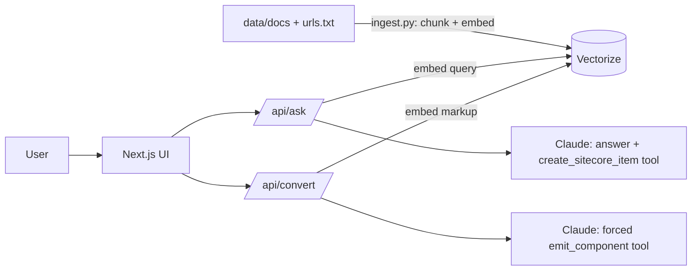

# SiteShift AI

An AI assistant for Sitecore teams moving to headless Next.js.

- **Ask:** RAG over Sitecore docs and team conventions. Every answer cites its sources. Ask it to draft a page and it calls a tool that returns a structured content item.
- **Convert:** Paste a legacy `.ascx`, `.cshtml`, or HTML rendering. It returns an accessible Next.js + Tailwind component, the Sitecore template fields it needs, and the accessibility fixes it made.

Built with Next.js (App Router) on Cloudflare Workers via OpenNext, Workers AI embeddings, Cloudflare Vectorize, and the Claude API (tool use + forced structured output). Python handles ingestion and evals.



## Setup (≈20 min)

```bash
npm install
cp .dev.vars.example .dev.vars        # add ANTHROPIC_API_KEY
cp .env.example .env                   # add CF_ACCOUNT_ID + CF_API_TOKEN
npx wrangler login
npx wrangler vectorize create siteshift-docs --dimensions=768 --metric=cosine

python -m venv .venv && source .venv/bin/activate
pip install -r ingest/requirements.txt
python ingest/ingest.py --dry-run      # check chunk counts
python ingest/ingest.py

npm run dev                            # http://localhost:3000
```

Deploy: `npx wrangler secret put ANTHROPIC_API_KEY` then `npm run deploy`.

If local dev can't reach Vectorize, use `npm run preview`, or deploy and test there.

## Build plan for the day

1. **Setup + ingest (hours 1–2):** Run setup. Add your own conventions to `data/docs/` and 15–30 public Sitecore doc URLs to `data/urls.txt`. Re-run ingest.
2. **Ask mode (hours 3–4):** Get cited answers working. Tune `minScore` in `lib/rag.ts` until off-topic questions return no sources.
3. **Convert mode (hour 5):** Try 3–4 real-shaped renderings (rewrite anything from work so nothing confidential goes in). Tighten the system prompt in `app/api/convert/route.ts` until output matches your conventions.
4. **Evals (hour 6):** Grow `evals/ask_cases.jsonl` to 10+ cases, run `python evals/run_evals.py`, and paste `evals/results.md` below.
5. **Ship (hour 7):** Deploy, record a 60-second screen capture, link it from varunmunigala.com and LinkedIn.

## Design decisions (interview talking points)

- **Grounding over memory:** answers come only from retrieved sources, with numbered citations and an explicit "not covered" path. A score threshold keeps irrelevant chunks out of context.
- **Forced tool output for convert:** `tool_choice` makes the model return a typed schema (component, template fields, a11y fixes), so the UI never parses free text.
- **Human in the loop:** drafted content items and components are shown for review, never written to Sitecore automatically.
- **Evals as a first-class step:** keyword, citation, and structure checks catch regressions when prompts or chunking change.

## Next steps

- Write approved drafts to Sitecore through its authoring/management API.
- Batch convert: point at a folder of renderings and output a migration report.
- Hybrid retrieval (keyword + vector) and a reranker for exact API names.
- LLM-graded evals for answer faithfulness.

## Eval results

_Paste evals/results.md here._
