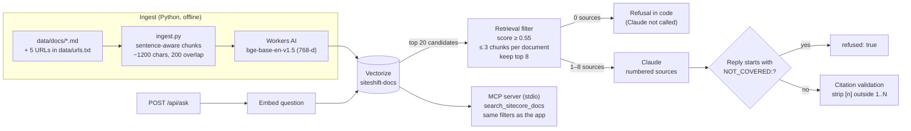

# SiteShift AI

SiteShift is a retrieval-augmented assistant for Sitecore teams moving to headless Next.js. It answers questions from the Sitecore Content SDK docs and a team conventions file, cites every claim, and refuses when the indexed sources don't cover the question. A second mode, Convert, turns a legacy `.ascx`/`.cshtml`/HTML rendering into a Next.js + Tailwind component. The same retrieval is also exposed as an MCP server, so Claude Code or Claude Desktop can search the docs directly. It runs on Cloudflare Workers (Next.js via OpenNext, Workers AI embeddings, Vectorize) with the Claude API.

**Live:** https://siteshift-ai.mvarun913.workers.dev

## Architecture



- **Per-document cap:** retrieval keeps at most 3 chunks from any one page, so a single long page can't crowd out other sources.
- **Deterministic refusal:** if no chunk passes the score threshold, the route refuses without calling Claude. If Claude can't answer from the sources, it starts its reply with a fixed marker, and the route sets `refused: true` in code instead of inferring a refusal from the wording.
- **Citation validation:** the route parses `[n]` citations from the answer, skipping code blocks. It removes any that don't point to a real source and reports which ones were valid and which were removed.
- **MCP server** (`mcp_server/server.py`): it exposes the `search_sitecore_docs` tool and a `siteshift://conventions` resource, and applies the same threshold, cap and embedding model as `lib/rag.ts`. It was tested with MCP Inspector and Claude Code.

## Evaluation

**Suite** (`evals/ask_cases.jsonl`, 12 cases):
- 8 must-answer questions: 3 Content SDK lookups, 4 team-convention questions and 1 paraphrased question.
- 3 should-refuse questions: an off-topic question, a pricing question, and a Sitecore feature that isn't in the index.
- 1 false-premise question, where either refusing or correcting the premise counts as a pass.

**Metrics** (`evals/run_evals.py`):
- **Pass:** every check for the case succeeds. That means the expected source was retrieved, the required terms appear in the answer, and the refusal is correct.
- **hit@8:** the expected document appears among the top 8 sources.
- **MRR:** the mean of 1/rank of the first expected source.
- hit@8 and MRR are measured over the 8 must-answer cases.

Every run is saved to `evals/results/` and tagged with what changed.

| Run | Change | Pass | hit@8 | MRR | Refusal acc. |
|---|---|---|---|---|---|
| baseline | | 83.3% | 87.5% | 0.719 | 75.0% |
| maxperdoc2 | Cap of 2 chunks per document | 91.7% | **100%** | 0.750 | 75.0% |
| deterministic-refusal | Refusal flag set in code | 75.0% | 100% | 0.778 | 100% |
| chunk-boundaries | Sentence-aware chunking | 91.7% | 100% | 0.754 | 100% |
| maxperdoc3-fixed | Cap raised to 3; eval scoring fix | 100% | 100% | 0.723 | 100% |
| query-prefix | bge query instruction prefix | 83.3% | 100% | 0.671 | 100% |
| prod | Deployed Worker | **100% (12/12)** | 100% | 0.723 | 100% |

What the history shows:
- **The per-document cap fixed retrieval.** Before it, one long page filled most of the top 8 and pushed the conventions doc out. The cap took hit@8 from 87.5% to 100%.
- **The chunking bug.** The original chunker split long paragraphs at fixed 1,200-character offsets and carried over the last 200 raw characters as overlap, so chunks started and ended mid-word or mid-sentence. The new chunker splits at sentence boundaries and starts the overlap on one too. On this suite it didn't improve retrieval: MRR went from 0.778 to 0.754. The fix was about clean source text, not a better score.
- **The query-prefix experiment was reverted.** Adding bge's recommended query instruction lowered MRR from 0.723 to 0.671 in two repeated runs, so it was reverted.
- **An eval scoring fix changed the denominator.** One run showed hit@8 at 88.9% because the false-premise case was counted in the retrieval metrics. Those metrics now cover only the must-answer cases.
- **Pass rate varies between runs.** Two runs of the same configuration (`chunk-boundaries` and `chunk-boundaries-2`) scored 91.7% and 75.0%, because Claude's answers change between runs. Retrieval metrics were the same across the repeats.
- **Production:** the deployed Worker passed 12/12 with hit@8 100% and MRR 0.723, which matches the final local configuration. A local run on Nov 6 (`after-auth-fix`) passed 11/12 (91.7%) with refusal accuracy 66.7%.

## Run locally

Requirements: Node 20+, Python 3.11+, and a Cloudflare account with Workers AI and Vectorize.

```bash
npm install
cp .dev.vars.example .dev.vars      # ANTHROPIC_API_KEY (used by the Next.js app)
cp scripts.env.example scripts.env  # CF_ACCOUNT_ID, CF_API_TOKEN, VECTORIZE_INDEX (used by the Python scripts)

npx wrangler vectorize create siteshift-docs --dimensions=768 --metric=cosine

python3 -m venv .venv && source .venv/bin/activate
pip install -r ingest/requirements.txt
python ingest/ingest.py --dry-run   # show chunk counts
python ingest/ingest.py             # embed and upsert into Vectorize

npm run dev                         # http://localhost:3000 (Vectorize is reached remotely)
python evals/run_evals.py --tag local --base-url http://localhost:3000
```

MCP server: `pip install mcp`, then `npx @modelcontextprotocol/inspector .venv/bin/python mcp_server/server.py`.

Deploy: `npx wrangler secret put ANTHROPIC_API_KEY`, then `npm run deploy`.

## Known limitations

- **Small eval suite, tuned on its own cases.** Every retrieval setting (threshold, cap, chunking) was chosen using these same 12 cases, and there's no held-out set, so the scores overstate how well it generalizes. Convert mode has no evals.
- **The rate limit isn't enforced yet.** `/api/ask` calls Cloudflare's rate-limit binding (`ASK_LIMITER`, 10 requests per 60 seconds per IP). On `workers.dev` it returned `success: true` for every request in testing (about 90 requests across two namespaces), so nothing is actually blocked. It's being replaced with a Durable Object counter.
- **Document metadata is page-level.** Each chunk stores only its page's title and URL, with no section heading or anchor. Citations point to a whole page, and the per-document cap groups by page.
- **The corpus is small:** 5 public Sitecore doc pages and one conventions file.
